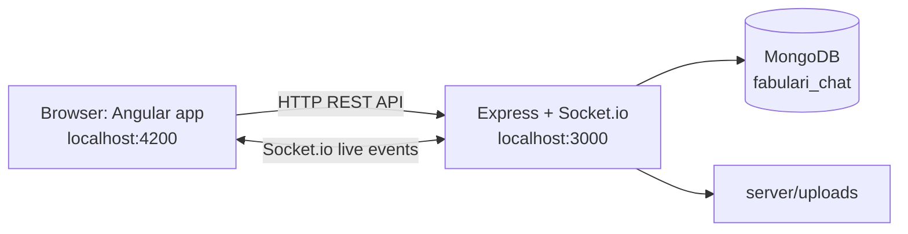
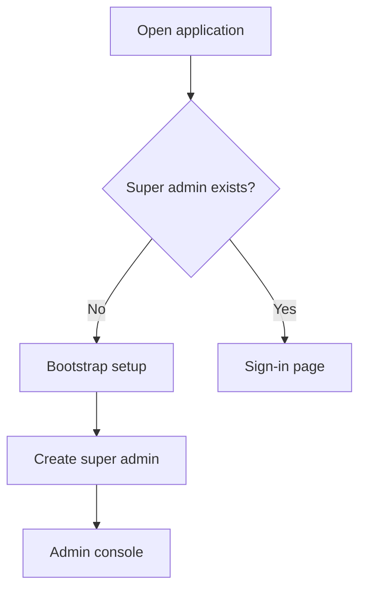
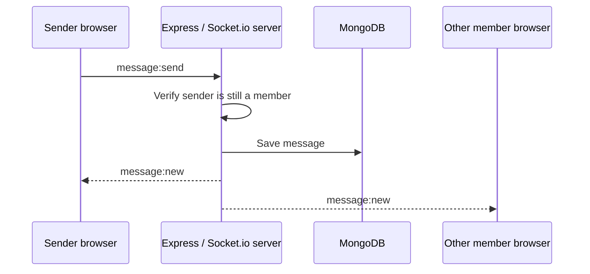
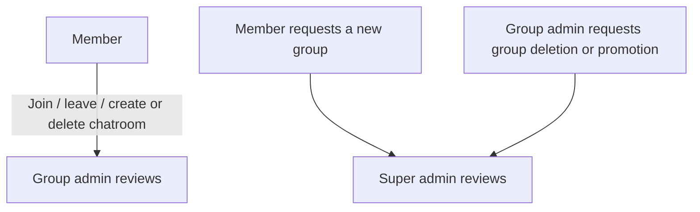
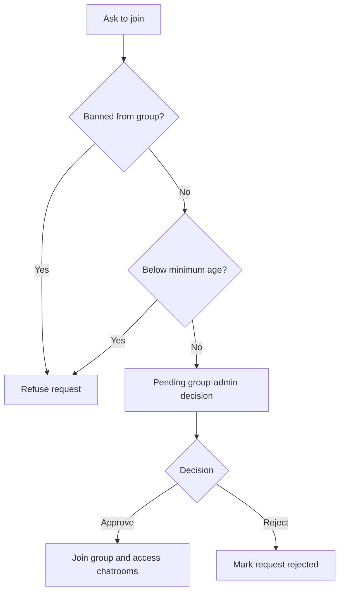
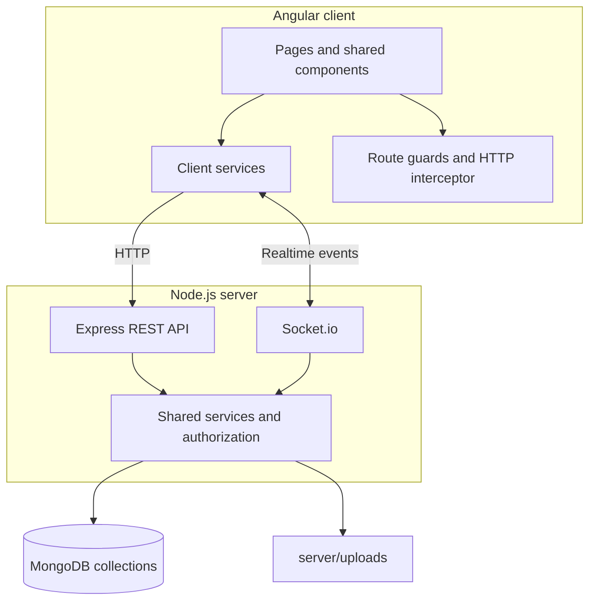
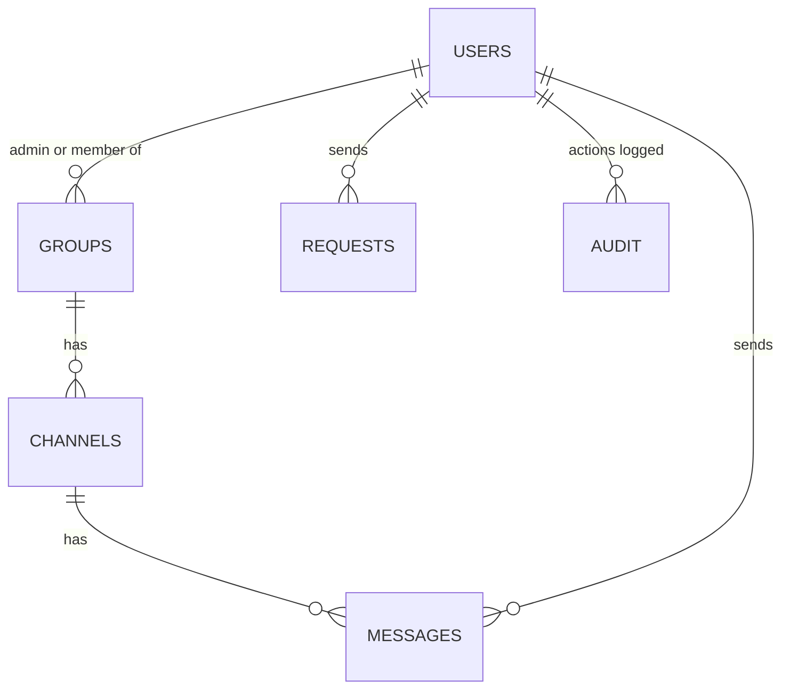

# Phase 2
## Ilsa Hashmi a5310047

## Specifications

### Project overview
Fabulari is a real-time group chat application built with the MEAN stack:
- **MongoDB** stores application data.
- **Express** provides the HTTP API.
- **Angular 20** provides the browser interface.
- **Node.js** runs the server.
- **Socket.io** delivers real-time chat and application updates.

Text messages and images are delivered live to members of a chatroom. The application also supports account management, groups, chatrooms, role-based administration, join/leave requests, moderation, and audit logging.

### Main functional requirements
- Register with an email, password, and date of birth; a profile picture is optional.
- Sign in using a username or email.
- Recover a forgotten password.
- Request membership of groups and chat in their chatrooms.
- Send text and image messages and receive new messages in real time.
- View online members and receive notifications when members join or leave a chatroom.
- Request groups and chatrooms, and request to leave a group.
- Allow group administrators to manage group settings, chatrooms, members, and requests.
- Allow the super administrator to manage system-wide roles, bans, user deletion, group requests, and audit information.
- Delete one's own account.

### Business rules and constraints
- On a new installation, the first visitor can create the super administrator.
- Email addresses uniquely identify accounts.
- Groups may enforce a minimum age. Users below that age cannot join and may be removed if the limit changes.
- A new group member can see at most three messages from before they joined.
- A member banned from a group cannot rejoin it.
- Chatrooms with no messages for 30 days are deleted automatically by default; `CHANNEL_INACTIVE_DAYS=0` disables this cleanup.
- The super administrator manages the system and does not participate directly in chats.
- Passwords are stored as bcrypt hashes; password hashes are not sent to the browser.

### Roles and permissions

| Capability | Member | Group admin | Super admin |
|---|:---:|:---:|:---:|
| Chat, send images, view online members | Yes | Yes | No |
| Request to join a group | Yes | Yes | No |
| Request a new group or chatroom | Yes | Yes | No |
| Approve join, leave, and chatroom requests | No | Own groups | No |
| Create or delete chatrooms directly | No | Yes | No |
| Edit group name, theme, and age limit | No | Yes | No |
| Add or remove group administrators | No | Yes | No |
| Ban a member from a group | No | Yes | No |
| Request group deletion | No | Yes | No |
| Approve group creation/deletion and promotions | No | No | Yes |
| Change system roles, hard-ban or delete users | No | No | Yes |
| View ban and audit logs | No | No | Yes |

### Main application flow


REST endpoints handle standard operations such as authentication, loading groups, and creating requests. Socket.io carries real-time messages, presence changes, join/leave notifications, and refresh events.

### First-time startup


## Server side functionality

### Server entry points and modules

| File or directory | Responsibility |
|---|---|
| `server/src/server.js` | Starts the server and its supporting services. |
| `server/src/app.js` | Configures the Express application and routes. |
| `server/src/config.js` | Reads configuration from `.env`. |
| `server/src/db.js` | Establishes the MongoDB connection. |
| `server/src/auth.js` | Handles sign-in tokens (JWT). |
| `server/src/socket.js` | Implements live chat events through Socket.io. |
| `server/src/services.js` | Shared group, member, and chatroom logic. |
| `server/src/realtime.js` | Publishes live updates to connected users. |
| `server/src/audit.js` | Records administrative actions. |
| `server/src/uploads.js` | Handles image uploads. |
| `server/src/jobs.js` | Runs hourly cleanup of inactive chatrooms. |
| `server/src/seed.js` | Optional demo-data setup. |
| `server/src/utils.js` | Shared helper functions. |
| `server/src/routes/` | Route modules for authentication, users, uploads, groups, channels, requests, and admin operations. |
| `server/test/` | Server-side tests. |
| `server/uploads/` | Uploaded image files. |

### HTTP API conventions
All API paths below are relative to `http://localhost:3000/api`. Routes marked **🔒** require a signed-in session/token. The manual documents these endpoints; request and response payload schemas are not fully specified there.

#### Authentication and accounts

| Method | Endpoint | Purpose |
|---|---|---|
| GET | `/auth/bootstrap` | Check whether first-time setup is required. |
| POST | `/auth/bootstrap` | Create the first super administrator. |
| POST | `/auth/register` | Register an account. |
| POST | `/auth/login` | Sign in. |
| GET 🔒 | `/auth/me` | Retrieve the signed-in user. |
| POST | `/auth/forgot-password` | Request password recovery. |
| POST | `/auth/reset-password` | Set a password using a reset link. |
| PATCH 🔒 | `/users/me` | Update the profile picture. |
| DELETE 🔒 | `/users/me` | Delete the current user's account. |
| POST 🔒 | `/uploads` | Upload a chat image. |

#### Groups and chatrooms

| Method | Endpoint | Purpose |
|---|---|---|
| GET 🔒 | `/groups/mine` | Load the user's groups and their chatrooms. |
| GET 🔒 | `/groups/discover` | List groups and the user's status in each. |
| GET 🔒 | `/groups/:gid/members` | List members; group admins can see full history. |
| PATCH 🔒 | `/groups/:gid` | Edit group name, theme, or age limit (admin). |
| POST 🔒 | `/groups/:gid/admins` | Promote a member to group admin. |
| DELETE 🔒 | `/groups/:gid/admins/:uid` | Remove group-admin privileges. |
| POST 🔒 | `/groups/:gid/bans` | Ban a member from a group. |
| POST 🔒 | `/groups/:gid/channels` | Create a chatroom (admin). |
| GET 🔒 | `/channels/:cid/messages` | Retrieve message history. |
| DELETE 🔒 | `/channels/:cid` | Delete a chatroom (admin). |

#### Requests

| Method | Endpoint | Purpose |
|---|---|---|
| POST 🔒 | `/requests` | Submit a request. |
| GET 🔒 | `/requests/mine` | List requests sent by the current user. |
| GET 🔒 | `/requests/incoming` | List requests the user may decide. |
| POST 🔒 | `/requests/:id/approve` | Approve a request. |
| POST 🔒 | `/requests/:id/reject` | Reject a request. |
| DELETE 🔒 | `/requests/:id` | Cancel the user's own pending request. |

Documented request types: `joinGroup`, `leaveGroup`, `createChannel`, `deleteChannel`, `createGroup`, `deleteGroup`, and `promoteMember`.

#### Super-administrator operations

| Method | Endpoint | Purpose |
|---|---|---|
| GET 🔒 | `/admin/users` | List all users. |
| PATCH 🔒 | `/admin/users/:id/role` | Change a user's role. |
| POST 🔒 | `/admin/users/:id/hardban` | Apply a hard ban. |
| DELETE 🔒 | `/admin/users/:id/hardban` | Lift a hard ban. |
| DELETE 🔒 | `/admin/users/:id` | Delete a user. |
| GET 🔒 | `/admin/bans` | View the ban log. |
| GET 🔒 | `/admin/audit` | View the audit log, with filters for `type`, `order`, `from`, and `to`. |

### Real-time Socket.io events

#### Browser to server

| Event | Purpose |
|---|---|
| `room:join` | Join/open a chatroom. |
| `room:leave` | Leave a chatroom. |
| `message:send` | Send text and/or an image. |

#### Server to browser

| Event | Purpose |
|---|---|
| `message:new` | Deliver a newly saved message. |
| `room:userJoined` | Notify the room that a member joined. |
| `room:userLeft` | Notify the room that a member left. |
| `presence` | Refresh the online-member list. |
| `room:deleted` | Notify clients that a chatroom was deleted and move them out of it. |
| `groups:changed` | Refresh groups and chatrooms. |
| `requests:changed` | Refresh request lists. |
| `account:changed` | Refresh account role/state. |
| `account:banned` | Sign out a banned account. |
| `account:deleted` | Sign out a deleted account. |

### Message delivery sequence


The documented flow checks current membership before saving and broadcasting a message. The manual does not specify the complete event payload format.

### Configuration

Settings are stored in `server/.env`.

| Variable | Default / example | Purpose |
|---|---|---|
| `PORT` | `3000` | Server port. |
| `MONGO_URL` | `mongodb://127.0.0.1:27017` | MongoDB connection address. |
| `DB_NAME` | `fabulari_chat` | Database name. |
| `JWT_SECRET` | Must be changed | Secret used to sign tokens. |
| `CLIENT_ORIGIN` | `http://localhost:4200` | Angular origin. |
| `CHANNEL_INACTIVE_DAYS` | `30` | Inactivity period before chatroom cleanup; `0` disables it. |
| `SEED_DEMO` | `false` | Enables demo data for an empty database when set to `true`. |

### Request approval flow


### Joining a group


## Angular documenation

### Components

The Angular client is described as an Angular 20 application. The manual names the following high-level component areas and pages. Individual component class names, inputs, outputs, and templates should be confirmed from the source code because the manual does not enumerate them.

#### Shared components

| Area | Responsibility |
|---|---|
| Logo | Displays the application identity; has a compact sidebar variant. |
| Avatar | Displays a profile picture or the first letter when no picture exists. |
| Toast container | Displays and dismisses notification toasts. |

#### Pages and routes

| Page | Route | Purpose |
|---|---|---|
| Bootstrap | `/bootstrap` | Create the first super administrator. |
| Sign in | `/login` | Sign in with username/email and password. |
| Sign up | `/register` | Register a new account. |
| Forgot password | `/forgot-password` | Start password recovery. |
| Reset password | `/reset-password` | Complete password recovery. |
| Chatroom picker | `/app` | Browse groups and chatrooms. |
| Chatroom | `/app/groups/:gid/rooms/:cid` | Participate in live chat. |
| Group information/management | `/app/groups/:gid/info` | View members and manage group settings. |
| Discover | `/app/discover` | Discover groups and request membership or group creation. |
| My requests | `/app/requests` | Review requests submitted by the current user. |
| Incoming requests | `/app/incoming` | Review requests that require the user's decision. |
| Profile | `/app/profile` | Manage profile details and delete the account. |
| Admin console | `/admin` | System-wide administration. |

#### Client structure

```text
client/
└── src/app/
    ├── core/        # Models, configuration, guards, interceptor
    ├── services/    # auth, socket, group, request, admin, toast
    ├── components/  # logo, avatar, toasts
    └── pages/       # bootstrap, login, register, password recovery,
                     # shell, home, room, group-info, discover,
                     # my-requests, incoming, profile, admin
```

### Services

| Service area | Documented responsibility |
|---|---|
| Authentication service | Signs users in/out, submits registration, and restores the session after reload. |
| Socket service | Connects the client to Socket.io and exposes live events. |
| Group service | Loads groups, determines group-admin status, tracks online members, and refreshes group data. |
| Request service | Creates and decides requests, counts incoming requests, and refreshes request lists. |
| Admin service | Supports super-administrator operations. |
| Toast service | Displays temporary notifications and supports dismissal. |
| HTTP interceptor | Adds the session token to requests and handles expired sessions. |
| Route guards | Direct users to appropriate areas and restrict role-specific routes. |

These responsibilities are summarized from the project manual and its test descriptions. Exact method signatures and internal implementation details are not provided in the manual.

### Models

The manual explicitly identifies these conceptual data models/collections:

| Model / collection | Documented fields or relationship |
|---|---|
| User (`users`) | Username, email, password hash, birth date, picture, role, hard-ban details. |
| Group (`groups`) | Name, theme, age limit, admins, members, past members, banned members. |
| Channel/chatroom (`channels`) | Group, name, last-activity time. |
| Message (`messages`) | Chatroom, sender, text and/or image, timestamp. |
| Request (`requests`) | Type, status, requester, and deciding user. |
| Audit (`audit`) | Management action, actor, action details, and time. |

The Angular model tests also mention request representations for joining a group, creating a chatroom, deleting a chatroom, and promoting a member, plus labels for each request type. Exact TypeScript interfaces are not included in the supplied manual.

### Client navigation and access control

The manual's test descriptions identify the following guard behavior:
- `authGuard` permits signed-in users and redirects signed-out users to sign in.
- `guestGuard` redirects signed-in users away from guest-only pages.
- `memberAreaGuard` directs members to the chat area and super administrators to the admin console.
- `superGuard` prevents regular members from entering the admin console.
- `homeRedirect` routes signed-out users to sign-in, super administrators to the admin console, and members to the chat area.

The HTTP interceptor adds the session token when signed in and signs the user out when the session has expired. The supplied manual does not specify the token's storage mechanism.

## Design Documents

### System architecture
The application uses a browser client, an Express/Socket.io server, MongoDB persistence, and a server-side uploads directory.



### Database relationships


The diagram reflects the relationships documented in the manual; it is a conceptual overview rather than a full database schema.

### Visual and interaction design
- The application uses a red, yellow, and blue theme.
- Each group chooses a colour shared by its chatrooms.
- The sidebar presents groups and chatrooms, with the user's profile at the bottom.
- Online members appear on the right side of the chat interface.
- Toasts report relevant real-time activity such as users joining or leaving.

### Security and authorization design
- Account passwords are hashed with bcrypt; only the hash is persisted.
- JWTs are used for sign-in sessions.
- Protected HTTP routes require authentication.
- Socket connections require a valid token.
- The server checks group membership before allowing a user to join a room or send a message.
- Role-based controls separate member, group-admin, and super-admin operations.
- Group bans, age limits, and audit logging support moderation and accountability.


## Testing Documentation

### Test strategy
The supplied manual records 116 automated tests across three suites. Its recorded results are historical documentation from the manual and have not been rerun as part of generating this document.

| Suite | Tools | Recorded tests | Recorded passing | Recorded failing |
|---|---|---:|---:|---:|
| Server | Node test runner, Supertest, socket.io-client | 45 | 45 | 0 |
| Angular | Jasmine + Karma | 63 | 60 | 3 |
| End-to-end | Playwright | 8 | 8 | 0 |
| **Total** | | **116** | **113** | **3** |

The manual describes the three Angular failures as display checks whose expected values had intentionally changed. The listed failing checks concern: returning `null` when there is no upload file, the compact logo variant, and avatar sizing.

### Running automated tests

MongoDB must be running for all three suites.

| Suite | Command | Notes |
|---|---|---|
| Server | `cd server` then `npm test` | Uses a separate `fabulari_test` database. |
| Angular | `cd client` then `npx ng test --watch=false` | Runs browser-based tests in Chrome. |
| End-to-end | `cd e2e` then `npm test` | Requires the server and client running with demo data on an empty database. |

### Coverage described by the test plan
- **Server:** authentication, protected routes, roles, group creation and membership, chatroom requests, age restrictions, bans, account deletion, audit filtering, inactive-chatroom cleanup, first-time setup, and Socket.io behavior.
- **Angular:** models, URL configuration, error handling, route guards, HTTP interceptor, authentication, group/request services, toasts, logo/avatar components, and login/registration pages.
- **End-to-end:** sign-up/login presentation, role-based navigation, real-time join/leave events, text/image messaging, group join approval, user administration, and audit log presentation.

